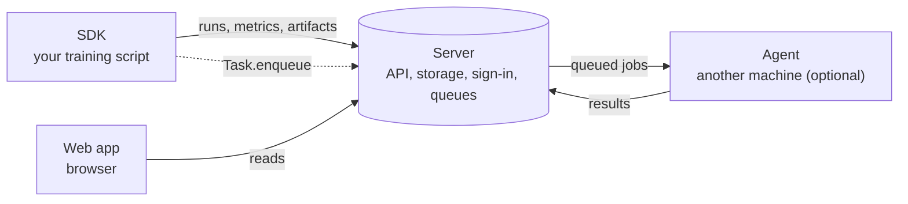

# Start here

This page explains what CairnML is, how its four parts fit together, which of them you need, and the order in which to set them up. Each part has its own README with the details.

## What CairnML is

CairnML records machine-learning work and keeps it in one place. A training script reports its parameters, metrics, logs and artifacts to a server. The same script can be sent to a separate machine to run there, and every run stays linked to the code, the data and the machine it used. Everything runs on your own infrastructure.

## The four parts

| Part | Repository | Role | Needed? |
|---|---|---|---|
| **Server** | [cairnml-server](https://github.com/gianlucapargaetzi/cairnml-server) | Stores runs, artifacts, datasets and queues, and serves the API, the sign-in service, object storage and the web app. | **Required.** Everything else connects to it. |
| **SDK** | [cairnml](https://github.com/gianlucapargaetzi/cairnml) (`pip install cairnml`) | The Python library in your training scripts. It records a run and can send a run to a queue. | **Required** for tracking from code. |
| **Agent** | [cairnml-agent](https://github.com/gianlucapargaetzi/cairnml-agent) (`pip install cairnml-agent`) | Runs on another machine. It takes jobs from a queue, runs them in Docker and reports the results back. | **Optional.** Needed only to run jobs remotely. |
| **Web app** | [cairnml-web](https://github.com/gianlucapargaetzi/cairnml-web) | The browser interface: projects, experiments, datasets, workers and queues. | Included. The server serves it at `http://<server-ip>/cairnml/`; there is nothing to install. |

Two further pieces are optional:

- **Dataset registry** ([cairnml-dataset-registry](https://github.com/gianlucapargaetzi/cairnml-dataset-registry)): public datasets with adapters that the SDK reads. Only needed for `Dataset.get_external`.
- **Examples** ([cairnml-examples](https://github.com/gianlucapargaetzi/cairnml-examples)): guided runs that build on the SDK. Useful after setup.

A GitHub App is also optional. It is set up on the server and only matters for remote jobs whose code is in a repository on `github.com`: the server refuses such a job until the App is installed on that repository. See the server README.

## What you need for what

| You want to | Server | SDK | Agent | GitHub App | Registry |
|---|:---:|:---:|:---:|:---:|:---:|
| Track a run from a script and see it in the browser | yes | yes | no | no | no |
| Run a job on another machine | yes | yes | yes | only for GitHub repositories | no |
| Read a public dataset with `Dataset.get_external` | yes | yes | no | no | yes |

## Setup order

1. **Start the server.** On a Linux host with Docker, clone the server repository and run `deploy/scripts/bootstrap.sh`. Note the server's address.
2. **Sign in.** Open `http://<server-ip>/cairnml/` and sign in as the admin named in `deploy/.env`. Other accounts are created by an administrator in Keycloak.
3. **Connect the SDK.** Run `pip install cairnml`, then `cairnml init http://<server-ip>`. Your browser opens the sign-in page; when the command prints `enrolled as ...`, this machine is connected.
4. **First run.** Track a script with `Task.init(...)`. The run appears in the web app under its project. No agent is needed yet.
5. **Optional: add an agent.** On the machine that should run jobs, install `cairnml-agent`, run `cairnml-agent init http://<server-ip>` (an admin signs in), then `cairnml-agent daemon --queue default --docker`. Send a task with `Task.enqueue(task, queue_name="default")`. The agent's machine appears under **Workers & Queues**.

If a machine has no browser, `cairnml init` and `cairnml-agent init` show a short code and an address instead. Open the address on another device, sign in, and enter the code.

## Glossary

| Term | Meaning |
|---|---|
| **Server** | The self-hosted stack that stores everything and serves the API, the web app and the sign-in service. |
| **Project** | A named group of tasks, experiments and models in the web app. |
| **Task** | One recorded run: its parameters, metrics, logs and artifacts. Created by `Task.init` in the SDK. |
| **Queue** | A named line of jobs. A task enqueued to a queue waits there until a worker takes it. |
| **Worker** | An agent running on a machine that takes jobs from one or more queues. |
| **Job** | A task sent to a queue for a worker to run. |
| **Model** | A model kept in the web app for a project. |
| **Dataset** | A versioned set of data. Versions are git commits (and DVC data) recorded with each run. |
| **Enrolment** | Connecting a machine to the server with its own key. Each SDK or agent machine enrols once; no access key is copied. |
| **Admin** | A user with the `cairnml-admin` role. Only admins enrol agents and manage the server. |
| **Registry** | The dataset registry: adapters that read public datasets. |

## Next steps

- Server: [cairnml-server/README.md](https://github.com/gianlucapargaetzi/cairnml-server#readme)
- SDK: [README.md](../README.md) and [docs/datasets.md](datasets.md)
- Agent: [cairnml-agent README](https://github.com/gianlucapargaetzi/cairnml-agent#readme)
- Examples: [cairnml-examples README](https://github.com/gianlucapargaetzi/cairnml-examples#readme)
